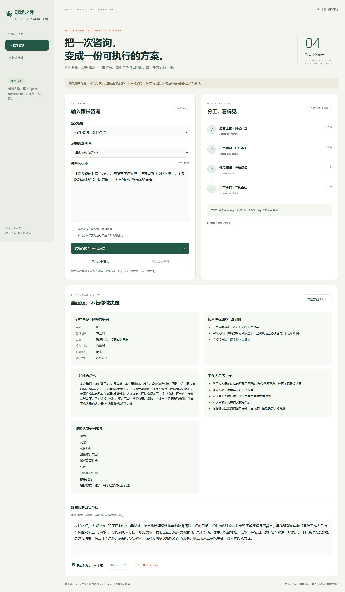
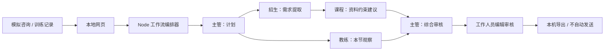

# openclaw-sports-multi-agent｜基于 OpenClaw 的少儿体育培训 Multi-Agent 业务自动化原型

**球场之外 / Courtside Agent Lab** · 一个使用模拟资料、保留人工审核的个人学习项目。



> 不是培训机构官方产品，不接入真实 CRM，不使用真实儿童信息。它不自动预约、不发送客户消息，也不宣称提升了真实转化率。

## 解决什么问题

家长咨询需要经历需求提取、课程判断、沟通与跟进；教练的简短记录需要整理成家长能理解的反馈。本项目把这两条业务链拆解为明确角色，并记录每次真实模型调用。

## 已实现

- 招生：主管计划 → 招生顾问画像 → 课程顾问建议 → 主管汇总。
- 教练：主管计划 → 教练助手整理本节观察 → 主管形成反馈草稿。
- 四个独立 OpenClaw Agent、独立工作区与任务会话。
- 自建本地网页：阶段状态、课程建议、执行证据、人工编辑审核与 JSON 导出。
- JSON 字段校验、未知价格/排课约束、输入长度与联系方式筛查。
- 失败即停、阶段超时、手动取消、单任务并发限制；不自动重试模型请求。
- 内置模拟案例和明确标识的历史演示回放，离线回放不调用模型。
- 无第三方 npm 运行依赖，使用 Node 原生 HTTP、子进程与文件系统。

## 这算哪种 Multi-Agent？

这是**代码编排的多 Agent 工作流**：应用通过 OpenClaw 官方 CLI 分别调用具名 Agent；上游结构化结果传给下游。主管 Agent 负责计划和综合审查，实际执行顺序由代码决定。

不是一个模型在同一段对话里扮演四个岗位；也不是主管自主调用 `sessions_spawn` 的 Swarm。本版采用确定性编排，是为了易测试、可复现、限制权限。自主子 Agent 编排留作后续扩展，不作已完成功能宣传。



## 快速开始

### 前置条件

1. Node.js 使用 OpenClaw 支持的版本；本机验证版本为 **26.10.0**。
2. OpenClaw 已安装；本项目验证版本为 **2026.9.6**。
3. 在 OpenClaw 本机配置向导中安装 DeepSeek provider 并配置 API Key；默认用 `deepseek/deepseek-v4-pro`。不要把密钥写入项目。
4. Gateway 已运行且本机 CLI 可以连接。当前版本网关运行期间不要使用 `agent --local`。

```powershell
# 使用正常可用的 Node；无需 npm install（无第三方依赖）
node scripts/setup.mjs
node src/server.mjs
```

Windows 可双击 `setup.cmd` 初始化，然后双击 `start.cmd` 启动网页服务。**start.cmd 的窗口需要保持开启**；它与只负责打开官方控制台的 `openclaw-dashboard.cmd` 不同。

打开 http://127.0.0.1:18890 。它是本项目自建界面；http://127.0.0.1:18789 是 OpenClaw 官方控制台，二者不同。

CLI 不在默认位置时，在运行前设置 `OPENCLAW_CLI` 为 `node_modules/openclaw/openclaw.mjs` 的绝对路径。例如：

```powershell
$env:OPENCLAW_CLI = 'C:\your-runtime\node_modules\openclaw\openclaw.mjs'
node scripts/setup.mjs
```

不要把 API Key 当作 `OPENCLAW_CLI`；此变量只是程序文件位置。`.env.example` 是配置说明，应用不会自动读取 `.env`。

### 实时运行

选择内置案例，确认模拟数据与 API 费用后运行。招生流程最多四次模型调用，教练流程三次；调用 DeepSeek 会产生费用。失败不会伪造下游结果，也不会自动重试。完成后编辑家长回复，确认人工审核，再导出。

### 不调用 API 的演示

点“查看历史演示”，显示仓库内保存的历史测试结果。页面会标明“离线 / 历史回放”，它不是当前模型推理，也不支持将历史样例保存为新审核记录。

### 命令行验证

```powershell
node --test tests/*.test.mjs           # 单元测试，不调用 API
node scripts/scan.mjs                 # 启发式公开文件检查
node scripts/demo.mjs newcomer        # 实时招生案例，会消耗余额
node scripts/demo.mjs coach           # 实时教练案例，会消耗余额
node scripts/setup.mjs --rollback     # 只撤销本项目新增 Agent 注册
```

## 仓库结构

```text
agents/          可公开的四个角色提示词
knowledge/       自定义模拟课程资料
examples/        模拟输入与脱敏后的历史演示结果
src/             CLI 适配、确定性工作流、本地 HTTP 服务
public/          自建前端（HTML/CSS/JS）
scripts/         初始化、回滚、实时演示与公开文件扫描
tests/           离线单元/接口测试
docs/            架构、演示、验证与简历说明
.local/          本机原始运行与审核记录，不提交 Git
```

## 数据与权限

- 密钥仍由 OpenClaw 本机凭据管理。应用不读取或导出密钥，不把它放进命令参数或网页。
- 新增 Agent 工具使用 `deny: ["*"]`，不开放系统操作、外部发送或文件读取；知识由代码注入任务。
- OpenClaw 会保留本机任务会话；本项目原始任务记录位于 `.local/`，均不纳入 Git。
- 默认只监听 `127.0.0.1`，校验 Host/Origin，使用 CSP 与文本 DOM 渲染。没有公开部署、多用户登录或企业权限系统。
- 输入筛查不是完整 DLP；请始终只用模拟资料，不能把真实客户数据交给此原型。
- 人工审核只是本地状态记录，不代表完成真实业务或获得客户同意。
- 安装前保存配置快照与 SHA-256；回滚仅删除本项目新增注册，保留 `main`、模型配置、工作区与会话文件。

## 测试与演示

见 [验证记录](docs/VERIFICATION.md)、[演示步骤](docs/DEMO.md)、[技术架构](docs/ARCHITECTURE.md)、[简历与项目说明](docs/RESUME.md)。

## 当前限制与后续迭代

模型输出仍需人工核实。单轮咨询，不做长期学员画像；固定流程，不做自主分支编排；没有数据库、真实消息发送、排课或 CRM。测试覆盖原型控制逻辑，不代表生产级安全性或行业有效性。

后续可增加：经过脱敏的更多测试案例、结果质量评分、主管自主 `sessions_spawn` 编排、只读 CRM 适配、权限与审计、多用户审批。任何真实儿童数据或客户发送接入都需要另行设计隐私与审批机制。

## GitHub 发布

建议仓库名 `openclaw-sports-multi-agent`。只提交本仓库可公开文件，不复制整个 `.openclaw`。先运行扫描并检查 `git diff --cached`。GitHub 上传步骤见 `docs/GITHUB.md`。

## 官方依据

- [Agent CLI](https://docs.openclaw.ai/cli/agent)：`--agent`、`--message-file`、`--session-id`、`--json`。
- [Agent 管理](https://docs.openclaw.ai/cli/agents)：独立 Agent 注册与工作区。
- [多 Agent 配置](https://docs.openclaw.ai/gateway/config-agents/entries-and-multi-agent)。
- [DeepSeek API](https://api-docs.deepseek.com/guides/harness)。

License: MIT。本仓库不包含 OpenClaw 本体；相关依赖遵循各自许可证。

## v0.2 可靠性升级

- 双击 `launch.cmd`：后台启动项目并打开网页。`status.cmd` 查看状态，`stop.cmd` 只停止身份验证通过、空闲的项目进程；不停止共享 OpenClaw Gateway。原 `start.cmd` 前台启动方式保留。
- 任务与人工审核原子保存到被 Git 忽略的 `.local/jobs/`，网页提供最近 100 条历史入口；重启后恢复结果。历史文件不会自动清理。
- 服务重启时，运行中的任务标记 `interrupted`；保留阶段证据，不自动重新付费。当前再次提交会运行全流程，尚无阶段续跑。
- 修复并发请求在读取请求体期间绕过单任务锁的问题。测试使用隔离数据目录。
- `node scripts/quality.mjs` 检查两份已保存真实输出的结构、会话独立性、未知价格和未发送边界；不是新实时测试，不代表整体准确率。
- 单 Agent 对照实验尚未完成，不声称 Multi-Agent 在质量或成本上优于单 Agent。
- 本次 24 项测试通过；真实停止/重启后，既有已审核回复保持一致。
- 本机保留 v0.1 源码归档。回退前停止项目，再运行 `powershell -NoProfile -ExecutionPolicy Bypass -File scripts/restore-v01.ps1`；脚本核对归档哈希、备份当前源码后覆盖旧版，不删除历史、新增文件或模型配置。归档不随 GitHub 发布。

## 第一步：模拟业务跟进台账
在任务历史打开完成的招生咨询，点击‘将当前咨询加入台账’，填写模拟负责人、跟进状态、下次跟进日期与备注后保存。重复点击不会重复建档。数据保存在被 Git 忽略的 .local/ledger，重启保留；版本号防止旧页面覆盖新修改。状态仅为人工记录，不代表已经预约或发送。联系方式拦截仅为启发式，继续只使用模拟资料。课程资料管理尚待下一步实现。

